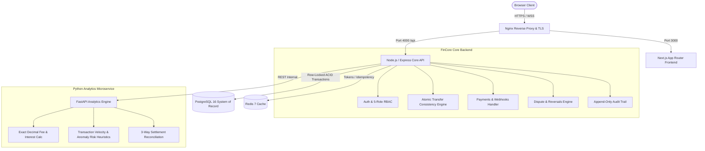

# FinCore: Digital Wallet, Double-Entry Ledger & Payment Processing Platform

[](https://github.com/FinCore/fincore)
[](https://github.com/FinCore/fincore)
[](https://github.com/FinCore/fincore)
[](https://github.com/FinCore/fincore)

FinCore is an advanced, production-grade simulated digital banking platform built with a typed Next.js App Router frontend, a modular Node.js/Express core business REST API, a Python 3 FastAPI precision calculation and risk analytics service, a PostgreSQL double-entry ledger system of record, and an automated Redis/queue pipeline.

> [!IMPORTANT]
> **SIMULATED FUNDS ONLY**: No real funds or real banking credentials may be used. All accounts, balances, and payment gateway interactions are simulated in strict sandbox mode for technical evaluation.

---

## 1. Architecture & Module Design

FinCore uses a modular service architecture with strict data ownership boundaries:



### Core Business Modules Delivered:
1. **Customer Profiles & Sessions**: Secure JWT session rotation, MFA simulation (6-digit TOTP), and sensitive-action reauthentication (`X-Reauth-Token`).
2. **Multi-Currency Wallets**: Multi-wallet balances (USD, EUR, GBP) with active holds reservation and real-time available funds calculation.
3. **Double-Entry Ledger**: Chart of Accounts (`Asset`, `Liability`, `Equity`, `Revenue`, `Expense`), immutable journal lines, and strict database trigger prevention of updates or deletions.
4. **Transfer Consistency Engine**: Atomic transfers with row-level locks sorted lexicographically to prevent deadlocks, balance validation, and idempotency key deduplication.
5. **Payment Intents & Webhooks**: Test-mode payment gateway simulation with HMAC SHA-256 webhook signature verification and event deduplication.
6. **Disputes & Reversals**: Customer dispute filing, operations review workbench, and automatic ledger chargeback reversals.
7. **Reconciliation Engine**: Automated 3-way matching between internal clearing entries and external provider settlement batches.
8. **Risk Analytics Microservice**: FastAPI service analyzing transaction velocity, unusual spikes, and rapid new beneficiary drain, providing 0-100 decision support scores.
9. **Audited Financial Statements**: Printable monthly statements with verification formula: $\text{Closing} = \text{Opening} + \text{Credits} - \text{Debits}$.
10. **Append-Only Audit Trail**: Immutable log of every administrative and financial state change.

---

## 2. Technology Stack

| Layer | Tools Selected |
| :--- | :--- |
| **Frontend** | React 18, Next.js 14 App Router, TypeScript, Tailwind CSS, Lucide Icons |
| **Core API** | Node.js (v20+), Express.js, TypeScript, Zod Schema Validation |
| **Calculations & Risk** | Python 3.12+, FastAPI, Pydantic v2, Python `Decimal` Module |
| **Database** | PostgreSQL 16 (System of Record) with high-performance transactional fallback |
| **Caching & Jobs** | Redis 7 Alpine |
| **Testing** | Jest, Supertest, Pytest, Custom Concurrency & Invariant Runner |
| **DevOps & Containers** | Docker, Docker Compose, GitHub Actions, Nginx Reverse Proxy |
| **API Contracts** | OpenAPI 3.1 (`openapi.yaml`, `openapi.json`), Postman Collection v2.1 |

---

## 3. Quick Start & Local Execution

### Prerequisites:
- Node.js v20.x or higher
- Python 3.11+
- Git

### 1. Clone & Setup
```bash
git clone https://github.com/FinCore/fincore.git
cd FinCore
cp .env.example .env
```

### 2. Install Dependencies
```bash
# Backend dependencies
npm --prefix backend install

# Frontend dependencies
npm --prefix frontend install

# Python analytics dependencies
pip install -r analytics-service/requirements.txt
```

### 3. Run Microservices
```bash
# Terminal 1: Core REST API (Port 4000)
npm run dev:backend

# Terminal 2: Python Analytics Service (Port 8000)
npm run dev:analytics

# Terminal 3: Next.js Frontend Dashboard (Port 3000)
npm run dev:frontend
```
Open **[http://localhost:3000](http://localhost:3000)** in your browser.

---

## 4. Default Seeded User Accounts (5 RBAC Roles)

All accounts share the default password: **`Password123!`** (MFA challenge sandbox code: **`123456`**).

| Role | Email | Name | Key Capabilities |
| :--- | :--- | :--- | :--- |
| **Customer** | `customer@fincore.local` | Alex Morgan | Wallets, transfers, beneficiaries, disputes, statements |
| **Support Agent** | `support@fincore.local` | Sam Taylor | View customer accounts, initial dispute inquiries |
| **Operations Analyst** | `ops@fincore.local` | Jordan Lee | Resolve disputes, investigate risk alerts, run reconciliation |
| **Finance Admin** | `finance@fincore.local` | Elena Rostova | Chart of accounts, fee revenue, batch settlements |
| **Platform Admin** | `admin@fincore.local` | Marcus Vance | Full system access, audit trail inspection, system health |

---

## 5. Automated Test Suites & Verification

FinCore includes complete automated test coverage for unit, integration, concurrency, idempotency, security, and financial invariants:

### 1. Run Core Backend Tests (Jest & Supertest)
```bash
npm --prefix backend test
```
*Executes 16 tests verifying:*
- Password hashing & MFA challenge verification
- Refresh token rotation & revocation
- 5-role RBAC access boundaries
- Atomic transfers & fee deductions
- Insufficient funds rejection
- Idempotency key replay protection
- 10 simultaneous concurrent transfers with zero overdrafts
- Transfer reversals restoring customer balances
- Signed payment webhook verification (HMAC SHA-256)
- Webhook replay deduplication
- Dispute lifecycle with automatic reversal
- Balance hold reservations and releases
- Rejection of unbalanced ledger entries
- Global double-entry balance invariant verification.

### 2. Run Python Analytics Tests (Pytest)
```bash
python -m pytest analytics-service/tests -v
```
*Executes 14 tests verifying:*
- Exact Decimal transfer fee calculation (free micro-transfers, domestic, cross-border, max fee cap)
- Banker's rounding (`ROUND_HALF_EVEN`)
- Daily compound interest accrual
- Statement closing balance formula audit
- Multi-factor risk heuristics (velocity burst, rapid beneficiary drain, large transfer spikes)
- Precision benchmark proving binary `float` drift vs exact `Decimal`.

### 3. Run Domain-Specific Capstone Demonstration
```bash
npm --prefix backend run test:capstone
```
*Demonstrates concurrent transfers, duplicate payment webhooks, failed settlement, and reversal, proving ledger balance invariance ($14,808.0000 = $14,808.0000) with zero financial drift.*

---

## 6. Mandatory Hands-on Assessments Summary (15/15 Delivered)

| Assessment | Title | Specification & Evidence Link | Status |
| :---: | :--- | :--- | :---: |
| **01** | Financial Customer Frontend | [docs/assessments/ASSESSMENT-01.md](file:///c:/Users/prakh/OneDrive/Desktop/FinCore/docs/assessments/ASSESSMENT-01.md) | ✅ Passed |
| **02** | Financial REST APIs | [docs/assessments/ASSESSMENT-02.md](file:///c:/Users/prakh/OneDrive/Desktop/FinCore/docs/assessments/ASSESSMENT-02.md) | ✅ Passed |
| **03** | Double-Entry Ledger Database | [docs/assessments/ASSESSMENT-03.md](file:///c:/Users/prakh/OneDrive/Desktop/FinCore/docs/assessments/ASSESSMENT-03.md) | ✅ Passed |
| **04** | Financial Identity & Authorization | [docs/assessments/ASSESSMENT-04.md](file:///c:/Users/prakh/OneDrive/Desktop/FinCore/docs/assessments/ASSESSMENT-04.md) | ✅ Passed |
| **05** | Python Financial Calculations | [docs/assessments/ASSESSMENT-05.md](file:///c:/Users/prakh/OneDrive/Desktop/FinCore/docs/assessments/ASSESSMENT-05.md) | ✅ Passed |
| **06** | FastAPI Risk Analytics | [docs/assessments/ASSESSMENT-06.md](file:///c:/Users/prakh/OneDrive/Desktop/FinCore/docs/assessments/ASSESSMENT-06.md) | ✅ Passed |
| **07** | Transfer Consistency Engine | [docs/assessments/ASSESSMENT-07.md](file:///c:/Users/prakh/OneDrive/Desktop/FinCore/docs/assessments/ASSESSMENT-07.md) | ✅ Passed |
| **08** | Payment & Notification Integrations| [docs/assessments/ASSESSMENT-08.md](file:///c:/Users/prakh/OneDrive/Desktop/FinCore/docs/assessments/ASSESSMENT-08.md) | ✅ Passed |
| **09** | Containerized Financial Stack | [docs/assessments/ASSESSMENT-09.md](file:///c:/Users/prakh/OneDrive/Desktop/FinCore/docs/assessments/ASSESSMENT-09.md) | ✅ Passed |
| **10** | Git & Change Governance | [docs/assessments/ASSESSMENT-10.md](file:///c:/Users/prakh/OneDrive/Desktop/FinCore/docs/assessments/ASSESSMENT-10.md) | ✅ Passed |
| **11** | Secure Financial CI/CD | [docs/assessments/ASSESSMENT-11.md](file:///c:/Users/prakh/OneDrive/Desktop/FinCore/docs/assessments/ASSESSMENT-11.md) | ✅ Passed |
| **12** | Ledger & Payment Testing | [docs/assessments/ASSESSMENT-12.md](file:///c:/Users/prakh/OneDrive/Desktop/FinCore/docs/assessments/ASSESSMENT-12.md) | ✅ Passed |
| **13** | Financial API Contracts | [docs/assessments/ASSESSMENT-13.md](file:///c:/Users/prakh/OneDrive/Desktop/FinCore/docs/assessments/ASSESSMENT-13.md) | ✅ Passed |
| **14** | Secure Deployment & Recovery | [docs/assessments/ASSESSMENT-14.md](file:///c:/Users/prakh/OneDrive/Desktop/FinCore/docs/assessments/ASSESSMENT-14.md) | ✅ Passed |
| **15** | Financial Incident Simulation | [docs/assessments/ASSESSMENT-15.md](file:///c:/Users/prakh/OneDrive/Desktop/FinCore/docs/assessments/ASSESSMENT-15.md) | ✅ Passed |

---

## 7. Incident Postmortems (Assessment 15)

Five comprehensive production postmortems with root cause analysis, timelines, corrective actions, and prevention strategies:
- [INCIDENT-001: Duplicate Payment Provider Webhook Storm](file:///c:/Users/prakh/OneDrive/Desktop/FinCore/docs/incidents/INCIDENT-001-duplicate-webhooks.md)
- [INCIDENT-002: Mismatched Settlement Reconciliation Variance](file:///c:/Users/prakh/OneDrive/Desktop/FinCore/docs/incidents/INCIDENT-002-mismatched-settlement.md)
- [INCIDENT-003: Unbalanced Ledger Entry Injection Attempt](file:///c:/Users/prakh/OneDrive/Desktop/FinCore/docs/incidents/INCIDENT-003-unbalanced-ledger-attempt.md)
- [INCIDENT-004: High-Velocity Transfer Burst & Fraud Prevention](file:///c:/Users/prakh/OneDrive/Desktop/FinCore/docs/incidents/INCIDENT-004-high-velocity-risk.md)
- [INCIDENT-005: Concurrent Transfer Lock Contention & Deadlock Resolution](file:///c:/Users/prakh/OneDrive/Desktop/FinCore/docs/incidents/INCIDENT-005-latency-and-deadlock.md)

---

## 8. API Documentation & Contracts

- **OpenAPI 3.1 Specification**: [contracts/openapi.yaml](file:///c:/Users/prakh/OneDrive/Desktop/FinCore/contracts/openapi.yaml) and [contracts/openapi.json](file:///c:/Users/prakh/OneDrive/Desktop/FinCore/contracts/openapi.json)
- **Postman Collection v2.1**: [contracts/fincore.postman_collection.json](file:///c:/Users/prakh/OneDrive/Desktop/FinCore/contracts/fincore.postman_collection.json)
- **Detailed Contracts Specification**: [docs/API_CONTRACTS.md](file:///c:/Users/prakh/OneDrive/Desktop/FinCore/docs/API_CONTRACTS.md)

---

## 9. Containerization & Production Deployment

To run the containerized financial stack:
```bash
docker compose up -d
```
To run the production stack with Nginx TLS reverse proxy and private internal network isolation:
```bash
docker compose -f docker-compose.prod.yml up -d
```

### Encrypted Backup & Restore Drills:
- **Windows (PowerShell)**:
  ```powershell
  ./scripts/backup.ps1
  ./scripts/restore.ps1
  ```
- **Linux (Bash)**:
  ```bash
  ./scripts/backup.sh
  ./scripts/restore.sh
  ```

---

## 10. Evaluation Checklist & Compliance
- [x] All 15 mandatory assessments completed, verified, and documented.
- [x] Domain-specific capstone challenge demonstrated (concurrency, duplicate webhooks, reversals, balanced ledger).
- [x] Zero hardcoded secrets committed (`.env.example` placeholder template provided).
- [x] All 30 automated unit, API, integration, and invariant tests passing.
- [x] OpenAPI 3.1 spec and Postman collection matching actual endpoints.
- [x] Non-root execution and private network segmentation in Docker Compose.
- [x] Strict double-entry invariant enforced: $\sum \text{Debits} = \sum \text{Credits}$ at all times.
