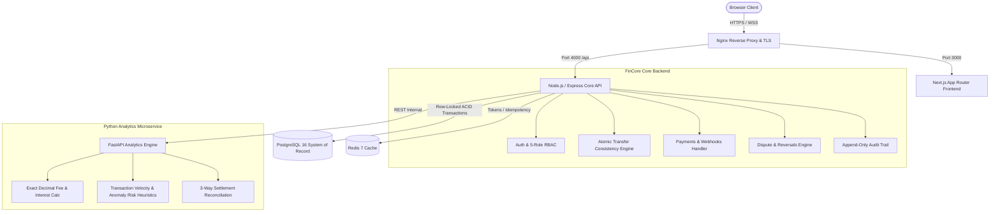

# FinCore Platform Architecture & Design Documentation

## 1. System Overview
FinCore is a simulated digital finance platform designed around true double-entry bookkeeping, multi-currency wallets, atomic fund transfers, real-time risk analytics, dispute resolution, and automated settlement reconciliation.

## 2. Bounded Contexts & Services
The architecture uses a modular monorepo separating business capabilities:
- **Frontend App (Next.js 14 App Router / React / Tailwind CSS)**: Customer & Operations portals, responsive dashboards, interactive modals for transfers, disputes, and live ledger invariant inspection.
- **Core Business API (Node.js / Express / TypeScript)**: The authoritative financial business engine. Manages user sessions, JWT/refresh rotation, 5-role RBAC, digital wallets, atomic transfers, payment intents, signed webhooks, dispute workflows, and immutable audit logs.
- **Analytics & Calculations Microservice (Python 3 / FastAPI / Pydantic)**: High-precision calculation engine enforcing Python `Decimal` arithmetic (zero floating-point drift), daily compound interest, tiered transfer fees, statement reconciliation, and multi-factor transaction risk scoring.
- **System of Record (PostgreSQL 16 / Transactional Engine)**: Relational database enforcing ACID transactions, row-level locking (`SELECT ... FOR UPDATE`), foreign key references, and database triggers strictly prohibiting modification or deletion of ledger entries and audit logs.
- **Cache & Message Broker (Redis 7)**: Rate limiting, idempotency store, session revocation, and asynchronous event buffering.
- **Reverse Proxy & Edge Security (Nginx 1.25)**: TLS/SSL termination, rate limiting, security headers, and network isolation.

## 3. Data Ownership & Authoritative Service Boundaries
| Data Entity | Authoritative Owner | Storage Engine | Modification Rules |
| :--- | :--- | :--- | :--- |
| Users & Sessions | Core Backend | PostgreSQL `users`, `refresh_tokens` | Mutated only via Auth service with bcrypt |
| Ledger Accounts | Core Backend | PostgreSQL `ledger_accounts` | Managed by Finance Admins |
| Journal Entries | Core Backend | PostgreSQL `journal_entries` | Created atomically with ledger lines |
| Ledger Entries | Core Backend | PostgreSQL `ledger_entries` | **Strictly Immutable** (DB trigger prevents UPDATE/DELETE) |
| Transfers | Core Backend | PostgreSQL `transfers` | State machine: PENDING -> PROCESSING -> COMPLETED / REVERSED |
| Risk Scores | Analytics Service | Stateless / Evaluated on demand | Decision support heuristics |
| Audit Logs | Core Backend | PostgreSQL `audit_logs` | **Append-Only** (Trigger prevents UPDATE/DELETE) |

## 4. Concurrency Control & Deadlock Prevention
Financial transfers execute under row-level locks on wallet accounts:
1. When multiple wallets are debited/credited in a single transaction, account IDs are sorted lexicographically (`accountIds.sort()`).
2. Row locks are acquired in strictly deterministic ascending order, preventing circular wait conditions and database deadlocks.
3. Available balance is calculated atomically with active holds deducted:
   $$\text{Available Balance} = \text{Total Balance} - \sum \text{Active Holds}$$
4. If available balance is less than transaction amount plus fee, the transaction immediately rolls back with `422 INSUFFICIENT_FUNDS`.

