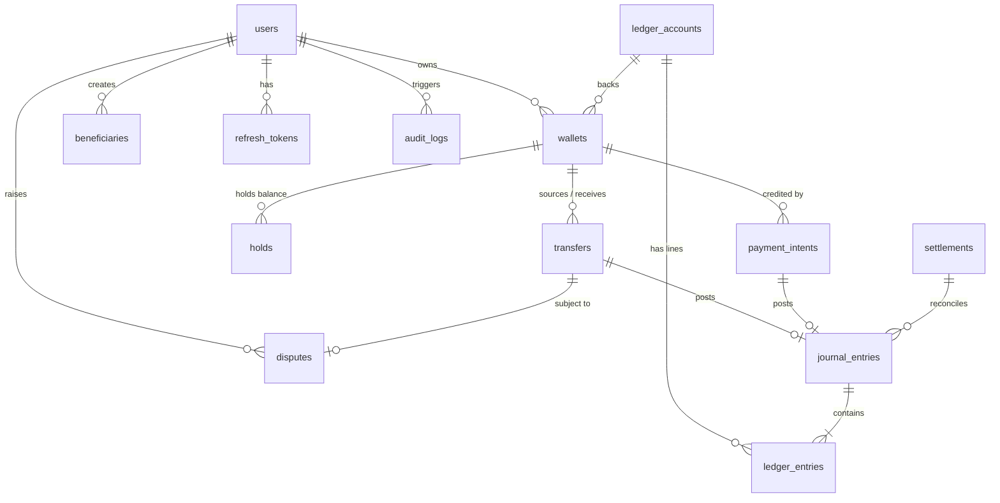

# FinCore Database Entity-Relationship (ERD) & Ledger Semantics

## 1. Relational Entity Diagram

## 2. Double-Entry Bookkeeping Principles
FinCore enforces standard accounting rules across all financial actions:
1. **Normal Balance Rules**:
   - Assets & Expenses: Increased by **DEBITS**, Decreased by **CREDITS**.
     $$\text{Asset Balance} = \sum \text{Debits} - \sum \text{Credits}$$
   - Liabilities, Equity & Revenue: Increased by **CREDITS**, Decreased by **DEBITS**.
     $$\text{Liability Balance} = \sum \text{Credits} - \sum \text{Debits}$$
2. **Fundamental Accounting Equation**:
   $$\text{Assets} = \text{Liabilities} + \text{Equity} + (\text{Revenue} - \text{Expenses})$$
3. **Journal Entry Balance Invariant**:
   For every journal entry $J$:
   $$\sum_{i \in J} \text{Debit}_i = \sum_{i \in J} \text{Credit}_i$$
   The database trigger `trg_ledger_entry_immutability` and application layer strictly enforce this equality to 4 decimal places before committing.

## 3. Standard Chart of Accounts
| Code | Name | Type | Currency | Normal Side |
| :--- | :--- | :--- | :--- | :--- |
| `1000-CASH-RESERVE-USD` | FinCore Settlement Reserve USD | ASSET | USD | DEBIT |
| `1001-CASH-RESERVE-EUR` | FinCore Settlement Reserve EUR | ASSET | EUR | DEBIT |
| `1002-CASH-RESERVE-GBP` | FinCore Settlement Reserve GBP | ASSET | GBP | DEBIT |
| `1100-GATEWAY-CLEARING-USD` | Payment Provider In-Transit Clearing USD | ASSET | USD | DEBIT |
| `2000-CUST-{USER}-USD` | Customer Deposit Liability USD | LIABILITY | USD | CREDIT |
| `3000-PLATFORM-EQUITY` | FinCore Initial Contributed Equity | EQUITY | USD | CREDIT |
| `4000-TRANSFER-FEE-REVENUE` | Transfer Processing Fee Revenue | REVENUE | USD | CREDIT |
| `5000-INTEREST-EXPENSE` | Customer Deposit Interest Expense | EXPENSE | USD | DEBIT |
| `5100-PAYMENT-PROVIDER-FEES`| External Gateway Processing Expense | EXPENSE | USD | DEBIT |

